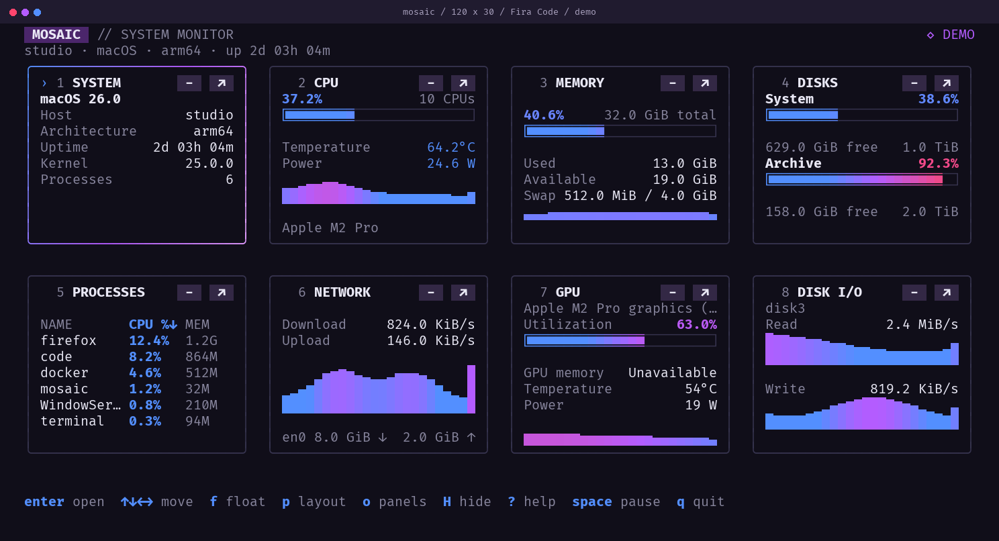
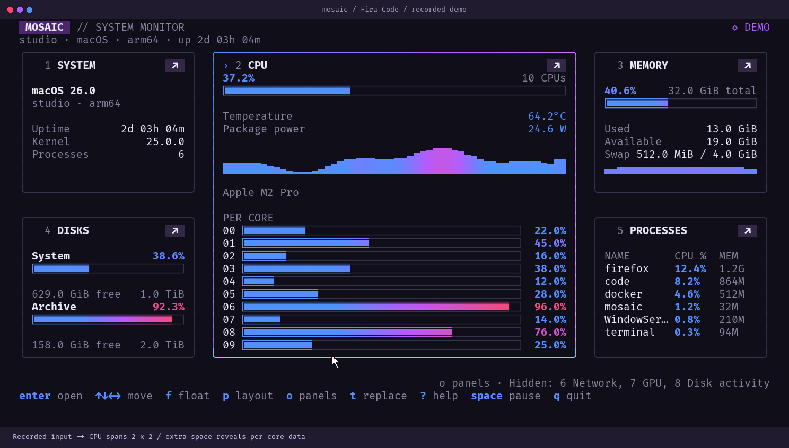
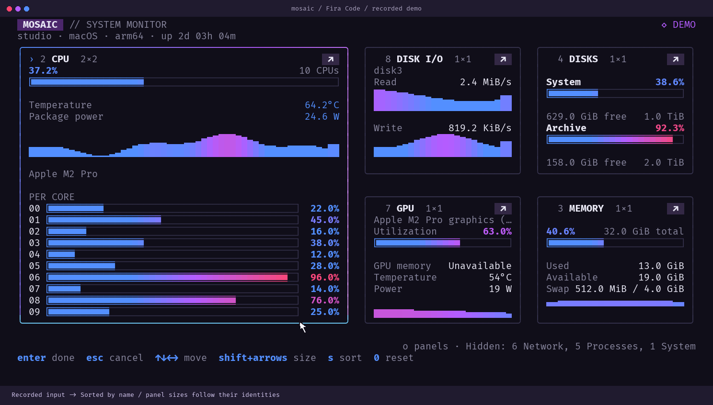
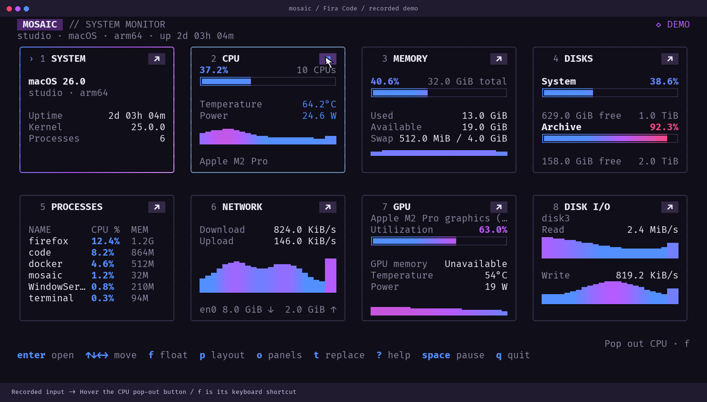
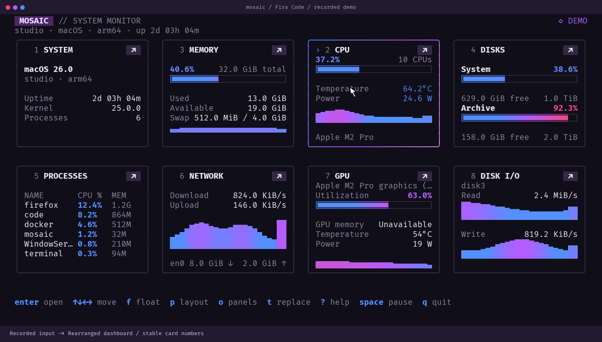
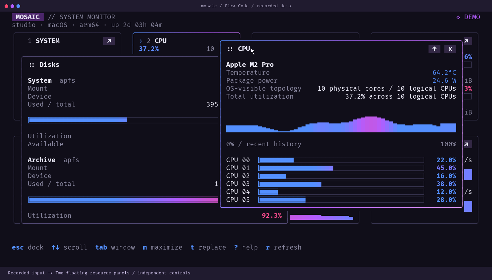
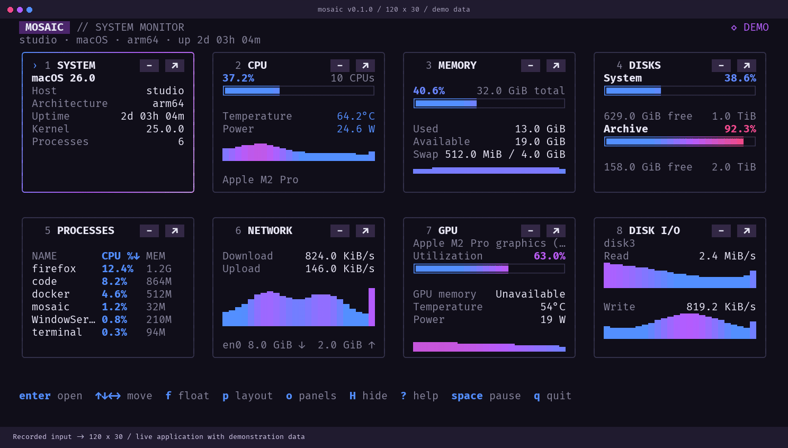
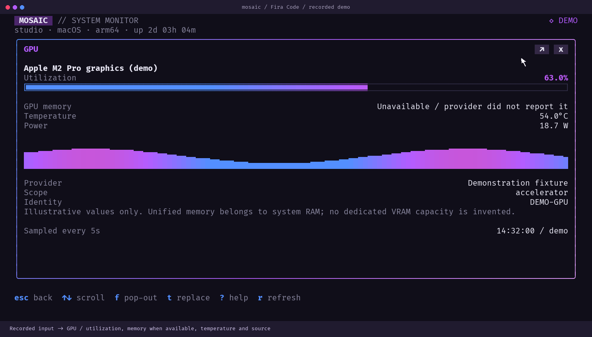
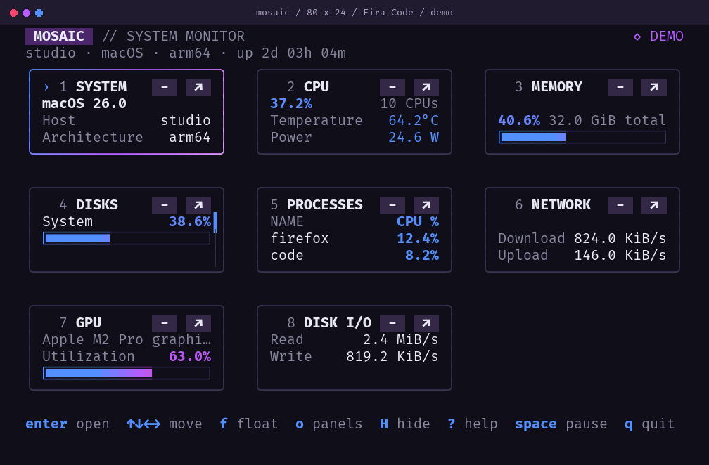

# Mosaic

A terminal task manager with eleven panel types and eight default responsive rounded cards, individual grid spans, rearrangeable layouts, movable detail windows, clickable controls, and a blue → neon purple → red usage scale. Built in Go with **Bubble Tea v2**, **Lip Gloss v2**, and **gopsutil v4**. Targets Linux, macOS, and Windows.



## Run

Download a build for your OS and architecture from [GitHub Releases](https://github.com/midona-rhel/mosaic/releases). Extract it, open your preferred terminal in that folder, and run `./mosaic --color` on macOS/Linux or `.\mosaic.exe --color` in PowerShell. Prebuilt binaries do not require Go.

Building from source requires **Go 1.26 or newer** and a Unicode terminal. Meters use portable block characters inside `[ ]` by default, including with Cascadia Mono, Consolas, and ordinary terminal fonts. No font installation is required.

For joined meters, install the optional [bundled Fira Code fonts](assets/fonts/README.md), select Fira Code in your terminal, and run:

```powershell
.\mosaic.exe --fira --color
```

On Linux/macOS: `./mosaic --fira --color`. `--meters fira` remains supported as an alias. `UNICODE_PROGRESS_BAR=true` also opts in. `--meters portable` overrides that environment variable. Fira meters use its private `U+EE00`–`U+EE05` glyphs; terminals cannot reliably report whether the selected font contains them. The main previews show the optional Fira style; [the portable preview](docs/preview-portable.png) shows the default at 120×30.

Bubble Tea adapts colors to the terminal and respects `NO_COLOR`. Pass `--color` to explicitly force true color. Utilization is blue at low values, blends into neon purple as it rises, and reaches red near saturation. Network graphs stay blue/purple: high throughput alone is not a health warning.

From a fresh checkout:

```sh
git clone https://github.com/midona-rhel/mosaic.git
cd mosaic
go run ./cmd/mosaic
```

Build a standalone binary:

```sh
go build -trimpath -o bin/mosaic ./cmd/mosaic
./bin/mosaic
```

In **PowerShell 5.1 or PowerShell 7** on Windows, build and run:

```powershell
go build -trimpath -o .\bin\mosaic.exe .\cmd\mosaic
.\bin\mosaic.exe --color
```

The optional `scripts/build.ps1` builds the same binary without Make or Bash. Run the executable directly in a terminal; Python is only needed for development previews and smoke tests.

## Windows hardware sensors

CPU utilization works without a helper. CPU temperature and package power need
an accessible hardware sensor driver; Windows does not expose these through its
standard CPU-load counters. Mosaic reads a running, WMI-capable
[Libre Hardware Monitor](https://github.com/LibreHardwareMonitor/LibreHardwareMonitor)
or Open Hardware Monitor instance. Enable CPU monitoring and confirm the readings
there first. GPU usage and memory use Windows WDDM counters and DXGI; optional
GPU temperature/power depend on the available driver provider.

## Terminals and fallback controls

PowerShell, cmd, Bash, zsh and fish are shells. The terminal hosting them controls mouse reporting, colors and font shaping. Mosaic targets modern Unicode/VT terminals, including **Windows Terminal**, Windows' modern console host, WezTerm, kitty, iTerm2, Terminal.app, GNOME Terminal, Konsole, and VS Code's integrated terminal. Keyboard monitoring does not depend on ligatures or mouse support. This list describes intended compatibility, not a claim of hands-on testing in every emulator.

On Windows, use Windows 10 1809 or later / Windows 11; the native console smoke check uses ConPTY. Bubble Tea enables Windows VT input/output and restores console state. Legacy consoles, `TERM=dumb`, and PowerShell ISE are not full interactive terminal targets. Microsoft explicitly [documents ISE's lack of interactive console-app support](https://devblogs.microsoft.com/powershell/console-application-non-support-in-the-ise/). Use `--snapshot` or `--json` when piping output or running without an interactive terminal.

- Colors adapt to the terminal's detected profile; `--color` explicitly forces true color and `NO_COLOR` is respected otherwise.
- `--meters portable` uses standard Unicode meters with other fonts; `--fira` opts into joined Fira Code glyphs.
- `--no-terminal-effects` disables pointer, cursor-guide, background-default and title overrides while retaining mouse input.
- `--no-mouse` keeps all keyboard actions available and allows normal terminal text selection.
- Without ligatures, `->` stays ordinary ASCII and the same hit targets still work. Fira Code is optional; font shaping is a terminal setting.
- Over SSH or inside tmux, set the correct terminal description and enable the host's mouse/true-color settings as needed. `--color` does not make an unsupported host understand true color.

## Configurable panels, one dashboard

| Card | Overview | Open it to see |
| --- | --- | --- |
| System | OS, hostname, architecture, uptime | Kernel, boot time, platform, virtualization |
| CPU | Total use, temperature, package watts, logical CPU count and history | Per-logical-CPU use, physical/logical topology, power domains and limits, clocks, processor metadata, thermal sensors and sources |
| Memory | Usage, capacity, available memory | Free memory, cache, swap, history |
| Disks | Multiple named mounts, usage and free space | All accessible mounts and device read/write rates |
| Processes | Names, CPU and memory; more rows as the panel grows | Filterable/sortable table, process inspection and termination |
| Network | Download/upload rates and history | Per-interface rates, counters, addresses, link flags and MTU |
| GPU | Real driver-reported use, dedicated/shared memory, temperature and power when available | All detected GPUs, memory, history, source, sample age and availability |
| Disk activity | Busiest device, read/write rates and separate histories | Per-device rates and histories; counter semantics |
| Battery (optional) | Charge, charging state, health, battery watts, cycles and voltage when exposed | Every system battery, sources and availability |
| Thermals (optional) | CPU/GPU temperatures and fan RPM | Identified sensor sources, control-sensor labels, fan readings |
| Connections (optional) | Accessible sockets, listener count, process names and local ports | PID, TCP/UDP state, numeric local/remote endpoints and visibility limits |

CPU watts are measured or derived from hardware energy counters, never estimated from utilization. Linux uses powercap/RAPL; Windows uses an existing compatible hardware-monitor WMI provider; macOS reads AppleSMC package keys with an Apple Silicon IOReport fallback, including mapped AppleCLPC counters on macOS 27. Availability depends on hardware, drivers, permissions and model/OS support. Missing readings say **Unavailable**. See the [platform sources and limitations](docs/telemetry.md#cpu-power-clocks-and-processor-details).

Snapshots default to **120×30**; the interactive app follows the actual terminal dimensions. CPU temperature and watts also remain visible at 80×24, where the smallest CPU card omits its graph to fit both.

Panels use the space available for useful data: multiple disk meters, swap and memory history, labeled process columns, interface totals and per-core CPU readings in larger panels. Mount and process lists show short names; inspection retains full paths. Usage stays visible through the blue/purple/red meters and percentages, without a LOW SPACE banner. Graphs and meters have a blank row before following text. At the smallest card height, disk shows the most occupied mount.

Use **↑↓←→** to focus an adjacent dashboard card; the bright rounded frame and › marker show the selection. Arrows follow the displayed arrangement after rearranging or resizing and stop at grid edges. **Enter** opens that card; **Esc** returns to it. **Tab / Shift+Tab** cycles cards, or floating windows when one is active. In details and process lists, **↑↓** scrolls or selects rows. Scrollable content has a right-side scrollbar; click its track or drag its thumb. Click **Name**, **CPU %**, **Memory**, or **PID** in process headings to sort; click again to reverse the order. The disk card accepts wheel input and prioritizes system storage, filtering virtual, boot, and duplicate mounts from both views. The footer shows the navigation appropriate to the current view.

Click a card to select it; press **Enter** to expand it. **Esc** closes one level at a time. In Processes, click a row or press Enter to inspect its owner, executable, command, status, start time, and memory. Press **x**, then **y** in the confirmation dialog to request termination; Enter does not confirm. Unix uses SIGTERM; Windows uses the OS termination API. Permissions and OS restrictions still apply. There is no force-kill action.

Press **t** on any card or resource window to choose its content. Arrow keys select and Enter applies; mouse selection works too. Duplicate resource panels are allowed. Each card keeps its size, position and numeric shortcut when its content changes.

[All eleven expanded panels at 120×30](docs/panels-120x30.png) · [All eleven at 80×24](docs/panels-80x24.png). These galleries include the overview and actual colored terminal output for System, CPU, Memory, Disks, Processes, Network, GPU, Disk activity, Battery, Thermals and Connections. Scroll detail views for additional devices or rows.

## Floating windows and mouse actions

Click a card’s **↗ button** or press **f** to pop it out. Hovering the button highlights it and shows its action and shortcut. A normal card click selects and highlights it. **Enter** opens the selected card’s full detail view.

Drag any **card edge or corner** to resize its width or height in whole grid units. **Shift+Left/Right** shrinks/grows width; **Shift+Up/Down** shrinks/grows height. A continuous white outline, using the same rounded border as the panels, previews the destination and the footer lists panels that would become hidden. Release to commit; Esc cancels. The live layout stays fixed during the gesture. System is limited to **2×1** grid cells. Widening it shows the OS artwork when space permits. Drag a **card title** onto another card to rearrange it. Growing a lower card upward gives it priority over the panels it displaces.

Press **p** for layout mode: arrows move the selected card, **Shift+arrows** resize it, **s** toggles alphabetical/original order, and **0** resets order and sizes. **Enter** keeps the layout; **Esc** restores the order and sizes from before layout mode. During an edge drag, Esc restores that card’s original size. Numeric hotkeys retain their original panel identities.

Size and order preferences survive terminal resizing during the current session. Spans temporarily clamp to the available columns and viewport height, and restore when space returns. The dashboard never scrolls: reading order is priority, from top left onward. Panels that cannot fit are pushed out and hidden, and return when space opens up. Grid dimensions depend only on terminal size: rearranging or growing a card cannot change the base height of other cards. Taller windows provide additional grid rows; requested sizes and relative order persist. Arrow/Tab navigation visits visible cards; 1–9 can open panels by stable number. Press **o** for the panel manager: all eleven slots appear in priority order with their saved span and visible row/column, **Hidden** (enabled but cannot fit), or **Removed** status. Select with arrows or click a row. **Space** adds/removes it, **Shift+Up/Down** changes priority, **s** toggles alphabetical/default order, **Enter** enables it and brings it first, and **f** opens details. Press **Shift+H** (or **Delete**), or click the **-** title button, to hide a dashboard panel directly. Restore it through **o**, then **Space**. Adding/removing only changes whether a panel is enabled; its saved order and size stay unchanged. An enabled panel can remain Hidden if it does not fit. Use the separate move, sort, or bring-first actions to change priority. Panels 10 and 11 are accessible through this menu. At very short terminal heights the list uses discrete pages reached with arrows. Live sessions save enabled/removed state, card order, width/height spans and panel types on exit to the OS user config directory (`mosaic/layout.json`). Use `--layout PATH` to choose a file or `--no-save-layout` to bypass saved settings. Demo/snapshot runs use the default layout without reading or writing preferences. Floating windows and process dialogs are session-only.

[Live window drag](docs/live-window-drag-fira.png) · [Panel manager](docs/panel-manager-fira.png) · [Additional panels](docs/extra-panels-fira.png) · [Click to select](docs/click-select-fira.png) · [Drag outline preview](docs/grid-resize-preview-fira.png) · [Hidden panel list](docs/hidden-panels-fira.png) · [Two-column layout](docs/thin-grid-fira.png)





Drag a floating **`::` title** to move it; drag **any edge or corner** to resize it. The actual window and its contents follow the pointer during movement and resizing. Release keeps the new bounds; Esc restores the original position and size. Multiple panels can overlap; clicking a window raises it. The title’s **↑ / m** button maximizes it and **x / Esc** docks it. **d** docks every window. Floating and expanded views have no grid Hide control; H/Delete does not hide their underlying cards. Expanded views have their own **↗** and **x** actions. Control rendering and click rectangles share the same definition.

Process inspectors have resizable edges, a title close button, and a local **Terminate** button. Terminate opens a separate dialog with real **Cancel** and **Terminate** buttons; Enter does not confirm. **Esc during a drag** restores original bounds. Terminal resizing keeps windows inside the content area.

Hotkeys are always at the **bottom left**, with bright keys and muted descriptions. Routine status chatter, the LIVE/interval badge, and the old OK/BUSY/HIGH legend are removed. Failures appear on the right; routine hover instructions are omitted. Cards and pop-outs retain rounded outlines, with a blue/purple/lilac blend for focus. A clickable panel under the pointer gets a soft blue border, distinct from the selected purple gradient; the resize edge gets a stronger cyan cue. Hover and edge painting never pass through a higher window. The original framed Fira Code gradient meters are restored; screenshot cells use integer pixel widths to avoid the earlier dark seams. Action buttons follow [Charm’s Lip Gloss layout example](https://github.com/charmbracelet/lipgloss/blob/main/examples/layout/main.go) and the short-help styling in [Bubbles’ help component](https://github.com/charmbracelet/bubbles/blob/main/help/help.go).









Optional panels use native providers on Windows, macOS and Linux. Slow queries run only when their panel is enabled or open and are cached for ten seconds. No extra controls change battery charging, fan speeds or network connections. [Provider coverage and limitations](docs/telemetry.md#additional-panels-panels-9).

The recording captures input sent to the running app; its pointer, click pulses and bottom input captions are recording annotations. All metrics shown in these previews are explicitly labeled demo data.

## CPU temperature

The CPU card and its expanded/pop-out view show temperature in °C, including in the compact 80×24 layout. The headline uses the hottest identified physical CPU sensor. Expanded details list the sensors, sources, sample age and hardware-reported critical limits. AMD Tctl is labeled as a control value and only becomes the headline when physical readings are absent. Temperature is read independently of CPU utilization and sampled every five seconds.

- **Linux:** kernel hwmon CPU drivers (Intel coretemp, AMD k10temp/k8temp/zenpower), with explicitly named CPU thermal zones as fallback. Requires the driver to expose readable sensors.
- **macOS:** the pinned gopsutil AppleSMC backend for Intel CPU diode readings and IOHID CPU sensor readings on Apple Silicon. Availability depends on hardware, macOS and permissions.
- **Windows:** read-only queries to an already-running **WMI-capable Libre Hardware Monitor or Open Hardware Monitor** provider with CPU sensors enabled. Mosaic does not install a kernel driver or elevate privileges. Generic ACPI thermal zones are excluded because they do not reliably identify CPU die temperature.

No reading is displayed as **Unavailable**, with the reason in CPU details. Demo readings remain labeled demo. Windows/macOS temperature providers have cross-build and parser coverage; native hardware validation remains pending. See the [source audit](docs/telemetry.md#cpu-temperature).

## GPU and platform-specific telemetry

GPU is a first-class dashboard panel. Select it and press Enter, press **7** in the default workspace, or use **g** to open an existing GPU card. Windows uses WDDM engine/adapter counters via CIM, Linux AMD uses amdgpu sysfs, Linux/Windows NVIDIA can use the driver-supplied `nvidia-smi`, and macOS reads optional accelerator registry properties. Missing fields stay unavailable. The GPU view records each source, its meaning and sample age; it keeps separate hardware inventory and WDDM LUID groups without inventing an association. Apple unified RAM is not labeled dedicated VRAM. GPU providers are cached for five seconds.



The [telemetry audit](docs/telemetry.md) gives the per-OS API and source-code references, calculations, caveats and validation gaps for CPU, GPU, memory, disk, network and processes. It documents unsupported Intel Linux device utilization, optional macOS driver keys, native Windows pagefile enumeration, and the difference between physical memory usage and memory pressure. The app does not claim complete telemetry on every GPU driver.

## Responsive behavior

All eight default panels fit at **80×24** (three columns, three rows) and **120×30** (four columns, two rows). All cards start **1×1**, including GPU. Battery, Thermals and Connections are optional additions. Existing saved layouts retain their sizes; **0** resets sizes and order without changing enabled panel choices. Breakpoints are 52, 78 and 112 terminal columns for two, three and four columns. Base cells share equal dimensions; each panel spans a whole number of those cells, including the intervening gutters. Packing follows the chosen reading order. Enlarged arrangements push lower-priority panels out of view; the dashboard never scrolls. Below 24×10, the app shows a resize hint.



## Controls

| Key | Action |
| --- | --- |
| `↑↓←→` / `hjkl` | Focus the adjacent dashboard card in that direction; stop at grid edges |
| `↑↓` / `jk` | Scroll details or select process rows |
| Left click | Select a card; inspect a process row in details |
| `Enter` | Open the selected card or inspect a process |
| `1`–`9` | Open a card by its stable number |
| `t` | Choose the current card’s panel type; duplicates allowed |
| `o` | Panel manager: Space adds/removes, Shift+↑↓ moves, s sorts, Enter brings first |
| `Tab` / `Shift+Tab` | Cycle dashboard cards or floating windows |
| `f` / click ↗ | Pop out a detail window |
| `Shift+H` / `Delete` / click - | Hide the selected panel; restore with o, then Space |
| Drag card title / `p` | Rearrange cards / enter layout mode |
| Drag card edge / `Shift+arrows` | Resize width or height by one base grid unit |
| `s` / `0` in layout mode | Toggle alphabetical/original order / reset sizes and order |
| `g` | Open an existing GPU card (or offer GPU in the picker) |
| Drag `::` title / any edge | Move / resize a floating window |
| `m` / ↑ button | Maximize the focused floating window |
| `d` / x button | Dock all windows / dock one window |
| `Esc` | Close dialog, then panel; finish search editing |
| `/` | Edit process filter (name or PID) |
| `s` with Processes selected | Cycle process sort: CPU, memory, PID, name (outside layout mode) |
| `c` / `Ctrl+U` | Clear filter / clear while editing |
| `x`, then `y` | Confirm termination of the inspected process |
| `n` / `Esc` | Cancel termination |
| `Space` / `r` | Pause/unpause displayed metrics / refresh |
| `+` / `-` | Slower / faster refresh (250 ms–10 s) |
| Mouse wheel / `PgUp/PgDn` | Scroll; page through processes |
| `Home` / `End` | First / last process or start / end of detail view |
| `?` / `q` / `Ctrl+C` | Help / quit / quit immediately |

## Options

```sh
go run ./cmd/mosaic --demo                     # Explicitly labeled demo, no process actions
go run ./cmd/mosaic --read-only                # Live monitoring, termination disabled
go run ./cmd/mosaic --interval 500ms           # Delay between collection cycles
go run ./cmd/mosaic --no-mouse                 # Allow normal terminal text selection
go run ./cmd/mosaic --color                    # Force true color, including with NO_COLOR set
go run ./cmd/mosaic --demo --snapshot          # Plain text 80×24 dashboard, then exit
go run ./cmd/mosaic --snapshot --width 120 --height 30 --color
go run ./cmd/mosaic --json                     # Live structured metrics, then exit
go run ./cmd/mosaic --panel gpu                # Start in GPU details
go run ./cmd/mosaic --no-save-layout           # Defaults without reading/writing preferences
```

Live snapshots establish two samples before exiting to calculate rates. The first interactive sample shows rate warmup; missing information stays unavailable. Process CPU uses **100% per logical CPU**, so a multithreaded process can exceed 100%. Total CPU is averaged to 0–100%. Sizes use binary units (KiB/MiB/GiB). Network summary excludes loopback; per-interface details include it. Interfaces may overlap (VPNs/bridges), so aggregate traffic is not a measure of unique internet bytes. Disk mounts can share storage; capacities are not summed. The root filesystem is used when containers expose no physical partitions.

`--read-only` disables termination. Demo mode never touches real processes. Before a live action, the collector rechecks the process start time to detect PID reuse and rejects PID 1 and its own PID. This reduces risk but cannot atomically bind the check and signal on every OS. Running as a normal user is enough for monitoring; inaccessible fields display a reason where available. Killing a process does not guarantee that it will exit or stay stopped.

## Development

```sh
go test -race ./...
go vet ./...
```

Optional POSIX terminal smoke test, Fira Code PNG/SVG previews, and mouse recording:

```sh
python3 -m venv .venv
.venv/bin/pip install -r requirements-dev.txt
go build -o bin/mosaic ./cmd/mosaic
.venv/bin/python scripts/smoke_pty.py
.venv/bin/python scripts/test_terminal_render.py
.venv/bin/python scripts/render_preview.py
.venv/bin/python scripts/capture_interactions.py
```

CI is configured to run tests on Linux, macOS, and Windows, plus cross-builds for amd64 and arm64. The Go tests cover all eight visible default panels and the three optional panels, content replacement, saved-layout round trips and corrupt-file rejection, safe termination of an owned child process, grid spans, collision-free packing, resize cancellation, responsive size restoration, spatial focus, bounded rendering, mouse hit locations, detachment/move/resize/dock, stacking and modal isolation, clickable actions, scroll preservation, process identity/selection, Unicode filters, timer lifecycle, guarded actions, and live collection. GPU tests verify optional fields, units, per-engine aggregation and representative provider output. The POSIX PTY and Windows ConPTY tests exercise real keyboard input, mouse reports, resizing, and alternate-screen restoration. PowerShell 5.1 and 7 launch tests check command output and exit codes. See the [CI runs](https://github.com/midona-rhel/mosaic/actions) for current native-runner results.

Source is split between `cmd/mosaic`, `internal/ui`, and `internal/metrics`. Data collection runs in serialized background commands; rendering and input stay in the Bubble Tea loop. History is bounded to 120 samples. Some underlying OS calls may not honor context cancellation promptly. Very large process sets or slow network-mounted disks can extend the collection interval; the UI remains interactive while they run. This version enumerates all accessible processes each cycle; GPU process lists and hierarchical process trees are not implemented.

Build all six release archives with `python3 scripts/release.py --version v0.1.0`.

See [research and interaction decisions](docs/research.md) and [validation notes](docs/validation.md). Licensed under MIT.


## Apple Silicon CPU diagnostics

The updated macOS build opens AppleSMCKeysEndpoint and reads model-specific M1–M5 CPU temperature keys. CPU package power falls back to native IOReport/AppleCLPC when SMC power keys are missing. No sudo or external hardware-monitor installation is used. Native verification of the repaired M5 path is pending.

Run Mosaic inside your preferred terminal application:

```sh
cd ~/Downloads/mosaic
./mosaic --color
```

The app uses the terminal that launches it. For a CPU sensor report without process/network/disk inventory:

```sh
./mosaic --cpu-diagnostics
```

See [the repair and pinned references](docs/telemetry.md#apple-silicon-cpu-repair-after-local-m5-feedback).

Compatibility coverage and open hardware gaps are tracked in [the telemetry audit](docs/telemetry.md#coverage-checkpoint-universal-hardware-requirement). Universal terminal and GPU support is not established by this release.

OS artwork uses the embedded catalogue of 531 artwork variants and 615 aliases from [Fastfetch](https://github.com/fastfetch-cli/fastfetch). The [vendored artwork and MIT license](internal/ui/osart/README.md) identify the exact source revision. System details use a compact window with the artwork beside the facts.

[OS artwork gallery](docs/os-artwork.png): macOS, Windows, Arch, Ubuntu, Fedora and Linux Mint rendered from labeled fixtures. Other recognized distros use their matching catalogue entry; unknown Linux distributions use the generic Linux logo. Full and small reference versions are selected by available space.

[Widened System card previews](docs/os-artwork-card.png) exercise the 2×1 grid
view. All 14 compact logos are generated from Simple Icons vectors with Chafa,
matching the bundled Fira Code Bold glyphs within the eight-row limit.
[Chafa logo gallery](docs/chafa-logos.png) shows the complete compact set.
Other distributions and larger System details retain the Fastfetch catalogue.

Compact artwork is at most eight rows, leaving a blank row below it. It uses
ordinary letters and punctuation; no block or Braille font coverage is needed.
`--ascii-logos` also restricts expanded artwork to plain ASCII.
